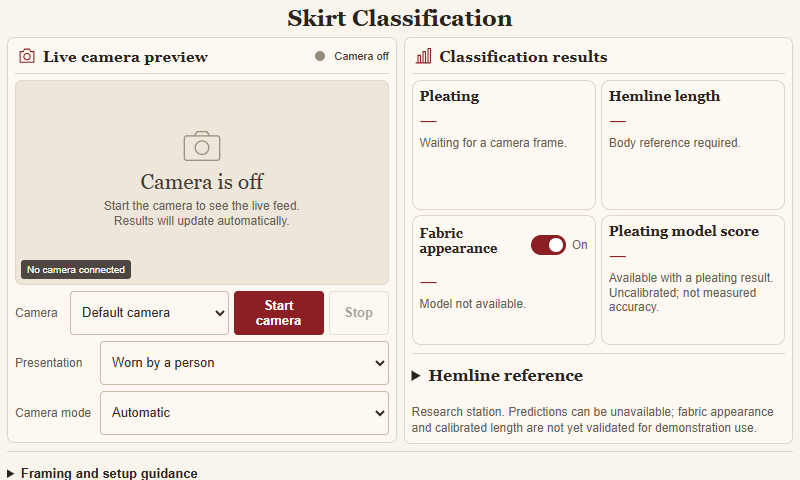

# SkirtFabricSense

[](https://github.com/joseacunodev-source/SkirtFabricSense/actions/workflows/software-checks.yml)

A single-camera research project for automatically classifying **pleated / non-pleated skirts**, estimating **body-relative hemline categories**, and optionally recognizing **fabric appearance**. The intended deployment is an offline Raspberry Pi station with a Waveshare 14447 display (800 x 480).

The camera sees the complete skirt in one live view. Software crops come from that same frame. Worn skirts are the primary use case; hanging, held and mannequin presentations are secondary.

## Current status

**Desktop research prototype - not yet an accepted full-feature or Raspberry Pi release.**

As of November 11, 2026, the selected desktop package is **station-v9 / research-v14**, with station-v8 retained for rollback. GPU training and desktop exports have been verified. The current station passed 12 saved-image HTTP jobs; its essential camera controls and output states fit the 800 x 480 browser viewport.

The 21 failed acquisition responses have been recovered without changing their historical bytes. The fabric-review tool and offline geometry annotation editor are implemented and tested. No background photographs were acquired by that failed download attempt.

| Area | Evidence and remaining limits |
|---|---|
| Data | 1,932 audited original images; grouped training/validation manifests preserved. Image counts are not independently verified garment counts. |
| Pleating and presence | On reused development groups: 44/66 skirt images accepted, 38/66 with correct pleating; 42/52 negatives rejected. Ten negatives were falsely accepted. These are not final test or live-camera accuracy. |
| Fabric | Optional research appearance path and a 17-item review queue. Independent observations, label decisions and accepted model quality remain open; appearance does not establish fiber composition. |
| Hemline | Nine-category rules, geometry/evaluation interfaces and an annotation editor exist. Automatic wearer-reference validation and measured calibration remain open. |
| Hardware | Pi, webcam and actual skirts are not available at the latest confirmation. Camera, resistive touch, ARM64 inference and physical acceptance remain unverified. |

See the [active task board](docs/TASK_BOARD.md), [latest checkpoint](records/continuation/latest.json), and [completed recovery work](docs/RECOVERY_IMPLEMENTATION_NOV11.md). Earlier README updates are preserved in [the dated history](README_HISTORY_NOV11.md).

## Interface

Actual camera-off application at 800 x 480, captured during browser layout verification:



Live preview, automatic frame submission, bounded inference and stale-result clearing are implemented. Missing or unsupported outputs stay unavailable. Model scores are uncalibrated outputs, not measured accuracy. Physical length in centimeters is not inferred from an uncalibrated image.

## Continue on another computer

```powershell
git clone https://github.com/joseacunodev-source/SkirtFabricSense.git
cd SkirtFabricSense
```

Before working, read [AGENTS.md](AGENTS.md), [HANDOFF.md](HANDOFF.md), [the agent handoff](docs/AGENT_HANDOFF.md), and [the documentation index](docs/DOCUMENTATION_INDEX.md). Verify the checkpoint and actual local processes before restarting an experiment.

The repository contains code, tests, documentation, manifests and experiment records. **Dataset photos, model payloads, acquired source snapshots and virtual environments are excluded from the public repository.** Restore authorized assets from private storage using the [asset transfer guide](docs/ASSET_TRANSFER.md). Cloning alone does not restore a training environment or runnable model station.

Read [the GitHub workflow guide](docs/GITHUB_WORKFLOW.md) for setup, authentication, working branches, checks and cross-computer handoffs. Use `git pull --ff-only` before a session and commit/push reviewed changes before switching computers. Git does not synchronize unsaved files automatically.

## Software checks

The GitHub workflow uses Python 3.12 and Pillow 13.0.0 for synthetic-fixture checks, without a GPU, camera, project photos or model binaries. The [workflow definition](.github/workflows/software-checks.yml) and [local instructions](docs/GITHUB_WORKFLOW.md#code-only-checks) specify the exact suite. Passing it establishes software contracts, not prediction quality or Pi compatibility.

Training, desktop tooling and Pi inference have separate environments. Consult [dependency records](requirements/README.md), [GPU setup](docs/GPU_SETUP.md), and [Pi deployment](docs/RASPBERRY_PI_DEPLOYMENT.md) before installing packages. Record every actual installation and environment change.

## Project records

| Location | Purpose |
|---|---|
| `app/` | Local camera station, inference adapters and browser interface |
| `tools/`, `tests/` | Data preparation, training, evaluation, annotation, packaging and checks |
| `data/` | Versioned registry, provenance, labels and grouped split manifests; photo payloads excluded |
| `records/` | Acquisitions, experiments, environments, validation and continuation evidence |
| `requirements/` | Separate environment specifications and recorded locks |
| `docs/` | Requirements, decisions, subsystem plans, review instructions and acceptance gates |
| `output/` | Curated thesis figures, progress screenshots, presentation and report |
| `skills/`, `templates/` | Portable agent guidance and reproducible record formats |

Start with [requirements](docs/REQUIREMENTS.md), [architecture](docs/ARCHITECTURE.md), [datasets](docs/DATASETS.md), [training](docs/TRAINING_PLAN.md) and [evaluation](docs/EVALUATION.md). The [thesis figures](docs/THESIS_FIGURES.md) and [dataset diagrams](docs/THESIS_DATASET_DIAGRAMS.md) distinguish actual evidence from planned final testing.

## Contributing and source rights

Follow [CONTRIBUTING.md](CONTRIBUTING.md) and the project-specific instructions in [AGENTS.md](AGENTS.md). Preserve exact bytes of frozen records, source provenance, garment grouping and protected source partitions. Do not tune on a locked test set or count crops as independent garments.

No blanket open-source license has been selected. Dataset, pretrained-weight and dependency terms remain separate; see [third-party notices](THIRD_PARTY_NOTICES.md). A public repository or an asset manifest does not grant permission to redistribute third-party data.

