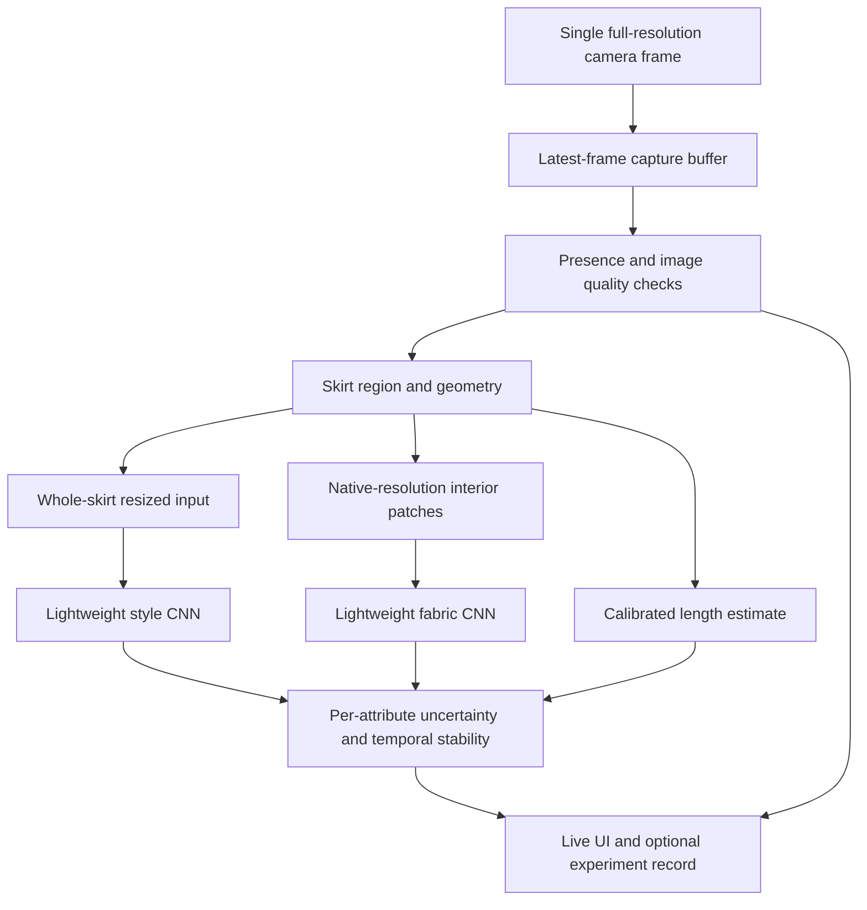

# Architecture

November 11 implementation: **R01–R04 software tasks are complete**. [Recovery and tool instructions](RECOVERY_IMPLEMENTATION_NOV11.md). Station-v9/research-v14 is selected, with v8 rollback. The 21 raw HTTP failures are preserved and verified as transport evidence; fabric/geometry reviewer tools are tested and documented; essential controls/results fit800 ×480. Human labels, automatic wearer geometry/calibration and physical camera/Pi acceptance remain open.

November 4 latest: station-v8/research-v13 adds requested camera modes and actual decoded-size reporting; v7 is rollback. The user reconfirmed no Pi or webcam. Fifty-two mocked checks and 12 saved-image HTTP jobs pass; physical camera/display and Pi acceptance remain open. [Camera mode evidence](CAMERA_MODE_NOV04.md).

Current motion update: optional value effects run only after fresh text is written; clearing cancels them synchronously. Repeated labels do not replay, scores do not animate per frame, and capture/expiry scheduling is unchanged. Reduced-motion and missing-API fallbacks preserve ordinary rendering. [Contract](UI_MOTION_OCT22.md).

Latest October22: station-v5/research-v10 adapts the supplied UI reference. Score rendering uses only finite current pleating output; no API, model, geometry or centimetre contract changed. Startup failure now calls the existing stop/invalidate path before showing an error, preventing late callbacks/results from surviving that failed session. [UI evidence](REFERENCE_UI_OCT22.md).

Later October22: research-v8/station-v3 preserve interruption during pending playback and respect initially muted tracks. The builder can select an explicit verified app bundle; old packages retain their original app/launcher. No model or geometry path changed. [Implementation and focused checks](CAMERA_SOURCE_UPDATE_OCT22.md).

October22 packaging state: portable station-v2 copies the existing camera-first app and selected scalar category-aware presence gate/localizer, with fabric smoke loaded only by explicit research opt-in. The four-way training head exports only its skirt probability; no new garment-category UI or automatic wearer references are introduced. Both package HTTP modes are verified on desktop. Length remains unavailable. [Current package](STATION_PACKAGE.md), [evidence](OCT22_INTEGRATION.md).

October 17 research extension: AutomaticPredictor accepts optional pose/fabric adapters. Pose operates only for worn frames and remains non-observed candidate metadata. Fabric uses the same original frame and unexpanded localizer ROI only when switched on; failure preserves pleating. Both are opt-in launch flags. No pose outputs manufacture geometry quality or calibration. [Implementation and verification](OCT17_NEXT_MILESTONE.md).

October 17: `app/worn_geometry.py` extracts conservative hem intervals from source-aligned binary masks and observed wearer references. The live server is not wired to it because no actual reference detector or measured calibration exists. Research-v6 includes the helper but does not enable live length. [Contract](WORN_GEOMETRY_EXTRACTOR.md), [verification](OCT17_INTEGRATION.md).

October 16: worn-by-a-person is the primary UI presentation, with other modes grouped as secondary. Guidance updates when presentation changes; existing cancellation/freshness behavior and per-mode geometry contracts remain intact. Worn geometry must associate the skirt with its actual wearer, not a generic standard body. [Plan](WORN_PRIMARY.md).

October 15: localizer loading verifies the recorded RGB/bilinear input contract, fixed mask threshold and exactly one input/output tensor before inference. This hardens deployment compatibility without establishing physical-camera validity. [Bundle verification](OFFLINE_RELEASE.md).

October 12: optional presence gating and a same-frame geometry evidence adapter are implemented. Presence remains disabled by default after failed coverage comparison; fabric remains unavailable. Geometry requires an external extractor, matching camera/reference IDs and a valid measured profile; current live HTTP submissions deliberately supply no verified camera configuration. An extractor failure preserves independent pleating. [Current evidence boundary](OCT12_INTEGRATION.md).

Status October 10: browser capture now feeds the bounded worker, with optional experimental mask localization and pleating. Fabric, calibrated geometry and reliable input validity remain incomplete. The diagram below describes the full target. See [current implemented boundary](LIVE_AUTOMATIC_PILOT.md).

## Capture and inference

Use one consistent full-skirt view. Keep raw capture resolution distinct from preview resolution and model input resolution. Crop fabric patches from the raw skirt region before downsampling. Pixel interpolation is not new evidence. Exclude obvious background, waistband hardware, labels, strong glare and seams when feasible; patch-selection behavior must be evaluated on unseen garments.

Start with a fixed user-guided region and simple background geometry for the controlled station. Compare localization against a lightweight learned detector only if necessary. A fixed region by itself cannot establish that an object is a skirt: a presence/validity mechanism and explicit negative tests remain required. Document any detector separately from classifier and segmentation claims.

Length requires a calibration anchor and visible boundaries. Preserve source coordinates and reference scale instead of asking a normalized crop to recover absolute length. The initial fixture-relative length definition is proposed; wearer-relative knee position cannot be inferred from mean height alone.

Inference consumes the latest eligible frame, dropping superseded frames rather than building an unbounded queue. Preview rendering does not wait for model inference. Schedule style/geometry and fabric at independently measured rates if the Pi cannot execute both at the preview frame rate. Record those rates and output age honestly.

## Candidate model contract

Propose a lightweight style classifier and a separate fabric classifier. MobileNetV2 is a baseline candidate, not a final selection. Compare whole-image and multi-patch fabric performance. Patch aggregation, calibrated class scores, thresholds, quality checks and temporal windows are configuration parameters selected on validation data. Adjacent frames do not create independent evaluation specimens.

Package each release with models, exact label ordering, input/output tensor metadata, preprocessing and quantization parameters, camera/calibration identifiers, supported classes and abstention logic. All files receive hashes. Inference must fail visibly on incompatible bundles rather than silently substituting labels or normalization.

## Runtime states

BOOTING -> CAMERA_CONNECTING -> WAITING_FOR_SKIRT -> CHECKING_FRAME -> ANALYZING -> STABLE_RESULT.

Transitions can enter UNCERTAIN, OUT_OF_FRAME, CAMERA_ERROR, MODEL_ERROR or STORAGE_WARNING. Each attribute can independently be unavailable. Confidence in style does not authorize showing a fabric result. Remove or invalidate old results on new-scene evidence, disconnection, model changes, or maximum result age. Keep optional saved records distinct from current live output.

## Proposed software boundaries

| Module | Responsibility | Interface |
|---|---|---|
| capture | Camera controls, timestamps, latest-frame buffer | Raw frame plus capture metadata |
| quality/localization | Framing, blur, presence, region geometry | Validity and coordinates |
| preprocessing | Versioned resize/crop/normalization | Model tensors plus provenance |
| inference | LiteRT-compatible model execution | Named attribute outputs |
| postprocessing | Calibration, uncertainty, temporal state | Stable/uncertain per-attribute result |
| UI | Preview, readable outputs, recovery messages | Consumes state; never owns training logic |
| records | Optional snapshots, CSV/JSON export, rotation | Versioned measurements and error records |

UI technology remains a measured choice: a local browser kiosk or native Python UI can satisfy requirements. If a web UI is selected, keep it bound locally by default and account for browser memory. Do not add a network backend merely to display offline inference.

## Model and app deployment boundary

Laptop performs training; Pi runs exported inference. The Pi does not need the notebook environment, GPU stack, or complete training dataset. Pin training and edge environments independently after compatibility tests. A successful x86 run or export is necessary but insufficient to claim ARM64 compatibility.

## Failure and recovery

Specify camera retry limits, model-load errors, log rotation, disk-space handling, graceful shutdown and restart supervision during implementation. Preserve readable diagnostics without continuous raw-video recording by default. Save image evidence only when explicitly enabled for collection/evaluation. Retain no network requirement for normal operation.

## Implemented file-image application (October 4)

`app/server.py` serves a local browser interface on loopback only. `app/inference.py` verifies model/contract hashes and actual tensor metadata before loading the installed interpreter. File uploads remain in memory; EXIF orientation is applied before source-coordinate cropping. Users select a full-skirt ROI and explicitly confirm framing. This is a development input path, not automatic localization. Predictions have independent unavailable fabric/length states and uncalibrated pleating scores. Image/ROI/confirmation changes invalidate old results; request generations discard late responses. A nonblocking inference lock rejects overlapping requests.

`app/review.py` provides a blind original-image queue without prior labels or scores. Reviewer names are self-reported. Append-only events preserve original image, manifest and frozen split hashes; they are pending reconciliation and never silently modify training labels. Dataset-free bundles can run analysis with review endpoints unavailable. These checks do not establish live-camera freshness, kiosk recovery or physical-display acceptance.

## Live controller implementation (October 5)

The camera-independent `app/live_state.py` now implements one active inference claim, one replaceable waiting frame, generation-based invalidation and capture-age expiry. It is tested through synthetic events, not wired to capture or the web application. See [controller contract and remaining integration](LIVE_CONTROLLER.md).

## Background image worker (October 5)

`app/pipeline.py` connects the controller to a single inference worker, copies submitted pixels, releases work on predictor errors and exposes bounded shutdown status. Saved-image TFLite integration is verified; capture, automatic quality/localization and web polling are not yet wired. See [pipeline contract](IMAGE_PIPELINE.md).

## Async web integration

The file-image UI now submits jobs to ImagePipeline and polls current-job status. A station-level job ID plus controller generation rejects superseded results; cancellation only invalidates the matching current job. [Contract](ASYNC_APPLICATION.md). This supersedes the earlier synchronous-web description for the current server.

## Camera-first UI (October 6)

The root page now provides browser-local camera preview and honest unavailable result states. The existing async image-testing flow moved to `/analysis`. Preview frames are not yet submitted to the worker. See [camera UI](CAMERA_UI.md).

## Hemline rule boundary

The hemline rule in `app/hemline.py` consumes already-estimated geometry and an explicit calibration profile. It does not detect anatomy or garments. Live output requires a localization/reference adapter before this rule can run; it cannot use the pleating model to infer body positions. [Contract](HEMLINE_GUIDE.md).
