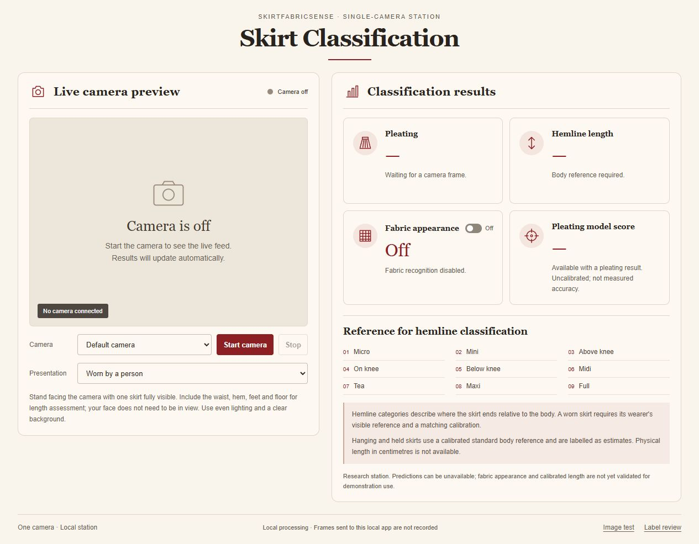

# Reference-inspired camera interface — October 22, 2026

The user supplied a visual example and asked what work can continue without the Pi or webcam. The interface now uses its cream background, burgundy accents, serif headings, large live preview and structured results. The live camera remains the primary workflow. No camera was started during this work.

Current research selection: **station-v5 / research-v10**, with station-v3 preserved for rollback. The first design package, station-v4/research-v9, is retained as an **unselected intermediate**: review found a startup failure could leave a completed result visible until expiry. The selected package fixes this by invalidating the generation/results and stopping tracks before displaying the startup error. Late unmute/ended callbacks cannot restore that failed session.

## Results and reference content

- Pleating, nine-class hemline, fabric appearance with its independent toggle, and pleating model score have separate fields.
- A score appears only for a supported current pleating result with a finite numeric value from 0 to 1. It is explicitly uncalibrated and not measured accuracy. Missing, malformed, unsupported or expired scores remain blank.
- Research fabric labels retain their source-appearance qualification. No fibre composition is certified.
- The nine hemline categories remain Micro, Mini, Above knee, On knee, Below knee, Midi, Tea, Maxi and Full. Worn skirts remain primary; other presentations are secondary.
- The example's centimetres, average-body dimensions, binary Short/Long labels, global confidence and YOLO model caption do not establish requirements or measurements. No such values or model claims were copied into results. There is no physical-length field in the current API.
- No detection rectangle is painted onto a changing preview from another frame's coordinates. No stock skirt photo or fabricated prediction is used as a live frame.

The user reference is stored for internal design traceability in the [evidence folder](../records/validation/2026-10-22-reference-ui/). Its authorship/reuse terms are unknown; it is not bundled with the app or admitted as training data. The UI uses system fonts, CSS and inline SVG icons, with no new dependency or external asset request.

## Verification

The Node fixture passes **18 camera/lifecycle scenarios and 21 score cases**, including the newly reproduced playback-failure regression. An independent agent reran and reviewed that fixture. The [station-v5 HTTP check](../records/validation/2026-10-22-station-v5-http.json) passes 12 saved-frame jobs using the unchanged models and three reused development originals; it does not measure new camera accuracy.

Browser checks show the camera-off layout at the default 1280×720 viewport and at 390×844. On the narrow viewport, client/scroll widths match 375px with zero overflowing elements; the 15px difference is the scrollbar. Camera status remains visible near preview controls. Fabric Off and held-mode guidance were checked without starting video; the real app's saved fabric preference was preserved. Temporary viewport overrides were reset.

The current loopback preview is at http://127.0.0.1:8766/. The agent started the packaged server, not the camera; the operator must choose Start camera separately. The [continuation pointer](../records/continuation/latest.json) records the owned process/session so another agent does not start a duplicate. Launch/rollback instructions are in [the station guide](STATION_PACKAGE.md). This preview loads no fabric model unless explicitly launched with research opt-in.

## Still feasible without devices

Source/label investigation, metadata grouping and source-partition checks can continue while preserving access/attribution gates. Saved-image model comparisons need justified data/protocol changes; repeating the completed fit does not supply independent evidence. Geometry annotation preparation and replay can continue, but reviewed wearer observations are still missing. UI, error recovery, integrity and packaging checks remain software tasks. Actual camera quality, measured calibration, unseen-garment tests and ARM64 benchmarks require their physical inputs.

No datasets, model weights, splits, installs or physical acceptance status changed. The project is still a research system with fabric quality, calibrated length and real-garment/Pi acceptance open.
